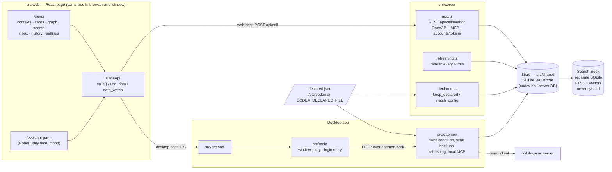
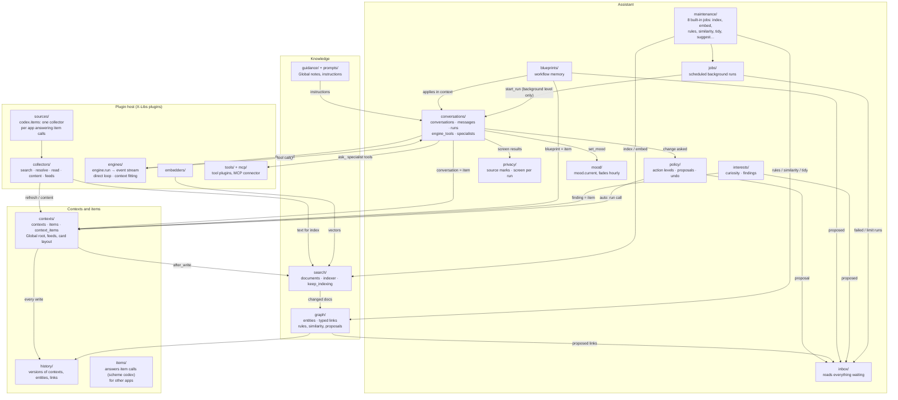
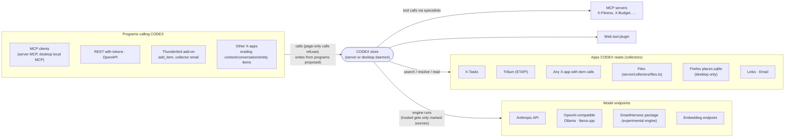

# CODEX: modules and how they interact

Drawn from `docs/1-architecture.md` and `src/` as of 2026-11-28.

## 1. Hosts and the store

## 2. Inside the store (src/shared)

## 3. The outside world

**What the three pictures show**

1. One React page runs on two hosts. In a browser it calls the server over `POST api/call/<method>`. In the desktop
   app it goes through IPC to Electron's main process, then over HTTP to the daemon's socket. The server or the daemon
   owns the SQLite store. The search index is a separate SQLite file that can be rebuilt at any time, and only the
   daemon syncs.
2. Conversations, blueprints and findings are all items in contexts, so History, search and the graph handle them the
   way they handle a task or a note. An engine never touches the store directly. Every tool call goes back through the
   conversation run, which screens results by source mark and sends any change through the action policy. Anything
   that waits for a decision ends up in the Inbox.
3. Collectors only read other apps and keep pointers to their items. Engines and embedders send text to a hosted
   endpoint only from sources marked for it. Outside programs reach CODEX through REST, MCP or the item calls, and
   none of them can make a page-only call.
